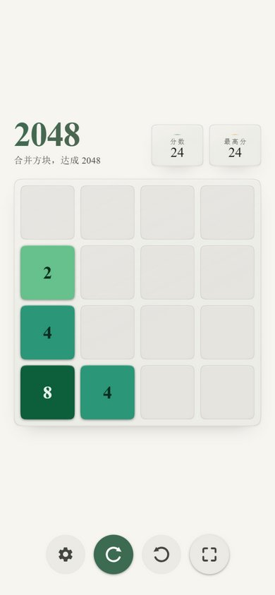
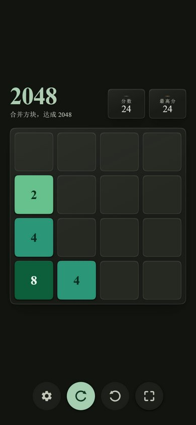
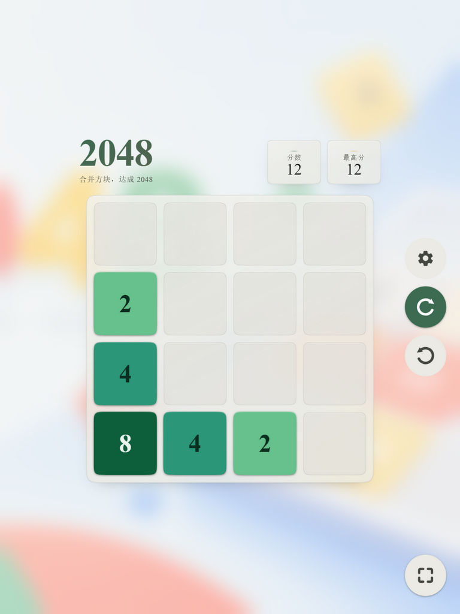
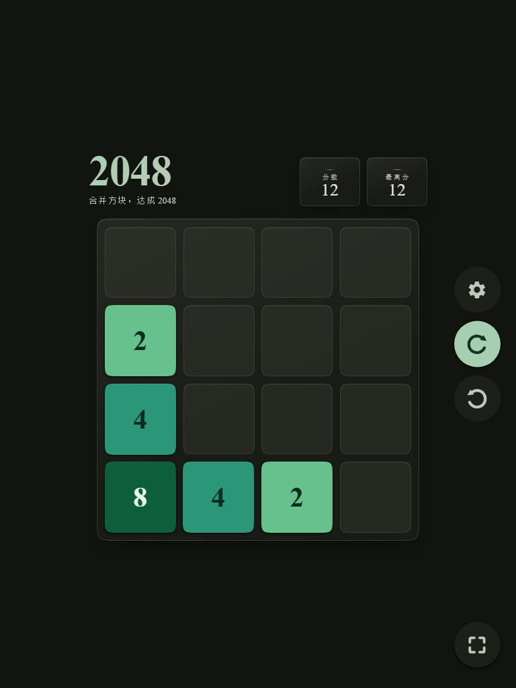
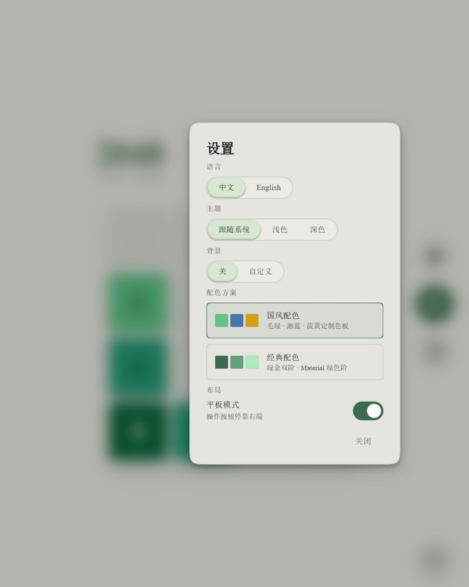
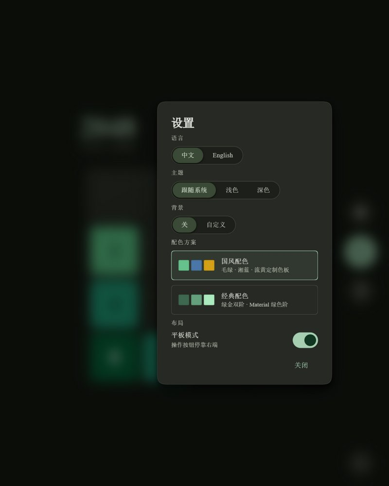
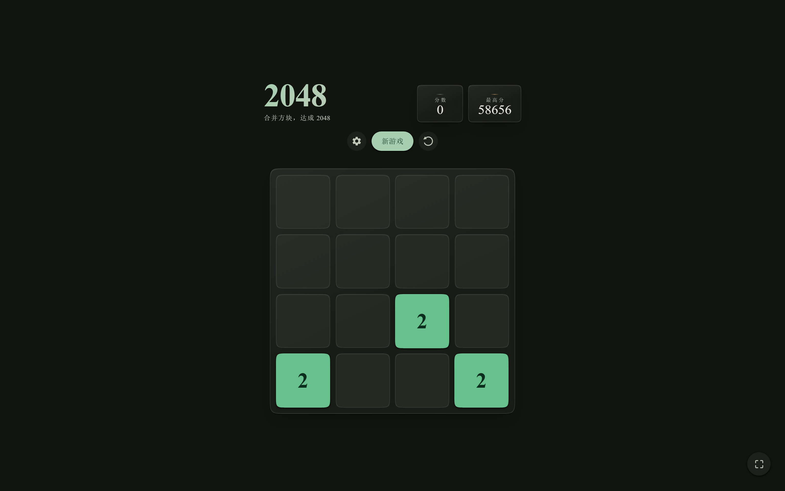

<h1 align="center">2048 · Material Design</h1>

<p align="center">
  A responsive, single-file 2048 game inspired by Material Design 3.
</p>

## Overview

Play in your browser with no installation, dependencies, or network connection. The complete game—including its styles, scripts, and fonts—is contained in `index.html`.

## Features

- **Gameplay:** Reach 2048, then keep playing. Undo up to 20 moves, and resume your saved game after a reload.
- **Input:** Use the arrow keys or `W` `A` `S` `D`. Swipe or drag on the board or any blank area of the page.
- **Appearance:** Choose the Guofeng, classic, or system color palette, independently of the light, dark, or system theme. The system palette derives the interface colors and tile shades from one accent color.
- **Custom backgrounds:** Select an image from your device and adjust its blur. The image is referenced locally and is not added to the HTML file.
- **Language:** Switch between Chinese and English; your preference is remembered.
- **Responsive layouts:** Play on desktop, tablet, and phone. On phones, action buttons dock at the bottom automatically. Tablet mode docks them along the right edge.
- **Motion and accessibility:** Supports reduced-motion preferences, keyboard access, and accessible labels. Game-over effects use a tile-shatter animation.

## Screenshots

### Phone

<p align="center">
  
  
</p>

### Tablet

<p align="center">
  
  
</p>

In tablet mode, action buttons dock along the right edge. The settings panel opens beside them.

<p align="center">
  
  
</p>

### Desktop

<p align="center">
  
  
</p>

## How to Play

Combine matching tiles to reach 2048. After reaching 2048, you can continue playing for a higher score.

| Action | Input |
| --- | --- |
| Move tiles | Arrow keys, `W` `A` `S` `D`, or swipe or drag on the board or a blank area |
| Start a new game | Select **New Game** |
| Undo a move | Select **Undo** (up to 20 moves) |
| Open settings | Select the gear button |
| Close a dialog | Press `Esc` |
| Toggle fullscreen | Select the fullscreen button when your browser supports it |

## Settings

Use the settings panel to change the color palette, theme, language, and background. Tablet mode is available on larger screens. On phone-sized screens, the action buttons move to the bottom automatically; the fullscreen button appears when supported by the browser.

The game saves your current board, score, undo history, best score, and interface preferences in the browser's `localStorage`. Data stays on your device and is not uploaded. A custom background image itself is not stored in the HTML file.

## Run or Deploy

Open `index.html` in a modern browser to play locally. To host the game with GitHub Pages, select the `main` branch and the `/ (root)` folder in the repository's Pages settings.

### System color palette

Select **Settings → Appearance → Color Scheme → Follow System** to use the browser-provided accent color when available. This color can differ from the operating system's accent color. **Settings → Theme** separately controls light or dark mode.

## Project Structure

```text
.
├── index.html
├── README.md
├── LICENSE
├── .gitignore
├── .nojekyll
└── docs/
    ├── preview-dark.jpg
    ├── preview-light.jpg
    ├── preview-mobile-dark.jpg
    ├── preview-mobile-light.jpg
    ├── preview-tablet-dark.jpg
    ├── preview-tablet-light.jpg
    ├── preview-tablet-settings-dark.jpg
    └── preview-tablet-settings-light.jpg
```

## Implementation

- Built with plain HTML, CSS, and JavaScript. There is no framework, build step, or external request.
- `GameCore` handles tile movement, merging, scoring, and game-state checks as pure functions.
- Interface fonts are embedded as WOFF2 subsets. The HTML is approximately 0.33 MB.
- Drag interactions use Pointer Events and `requestAnimationFrame`, with responsive tile movement and edge rebound effects.
- Browser storage keys use the `md2048-` prefix. The game does not send saved data to a server.

## Browser Support

Designed for modern versions of Chrome, Edge, Firefox, and Safari. The game uses Pointer Events, CSS custom properties, and `backdrop-filter`. Reduced-motion preferences disable motion effects while preserving normal gameplay.

## License

The code and original assets are provided under the [MIT License](LICENSE). Any third-party font rights remain with their respective owners.
