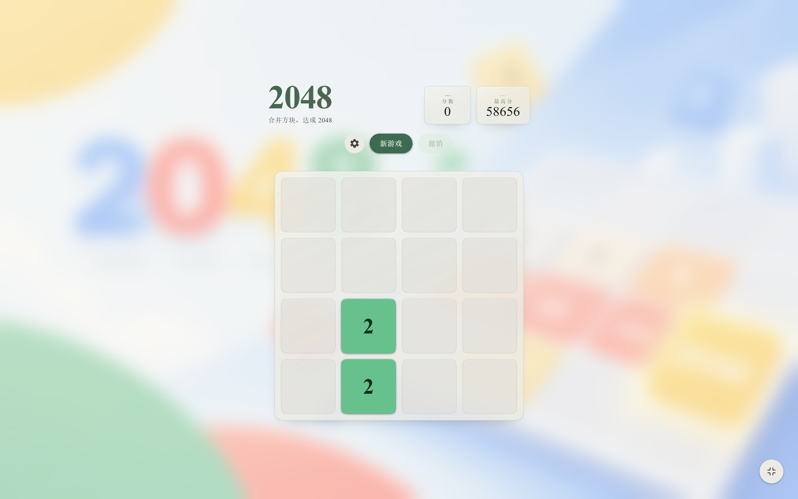
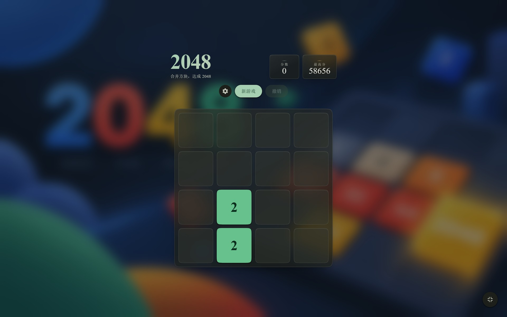

<p align="center">
  
  
</p>

<h1 align="center">2048 · Material Design</h1>

<p align="center">
  一款 Material Design 3 风格的 2048 游戏：单文件、零依赖、离线可玩。
</p>

* * *

## 特性

-   **Material Design 3** 视觉风格，森林绿主色与奶油底色
-   **两套配色**：国风配色（毛绿 · 湘蓝 · 流黄）与经典配色（绿金双阶）
-   **明暗主题**：跟随系统 / 浅色 / 深色，首帧无闪烁
-   **三语界面**：中文 / English / 日本語，选择会被记住
-   **键盘操作**：方向键或 `W` `A` `S` `D`
-   **触摸与鼠标拖拽**：跟手移动、挤压形变与边缘回弹动画
-   **撤销**：最多回退最近 20 步
-   **达成 2048 后可继续**挑战更高分，最高分保存在本地
-   **响应式布局**，适配手机安全区，支持全屏模式
-   尊重系统的「减少动态效果」设置，提供无障碍标签与键盘可达性

整个游戏只有 **一个 HTML 文件**，字体与背景图均已内嵌，不需要网络、构建工具或依赖安装，断网也能直接玩。

## 操作说明

| 操作 | 方式 |
| --- | --- |
| 移动方块 | 方向键 / `W` `A` `S` `D`，或在棋盘上滑动 / 拖拽 |
| 新游戏 | 「新游戏」按钮 |
| 撤销 | 「撤销」按钮（最多 20 步） |
| 设置 | 右上角齿轮：配色、主题、语言 |
| 全屏 | 右下角全屏按钮（浏览器支持时显示） |
| 关闭弹窗 | `Esc` |

## 本地运行

直接双击 `index.html` 即可。也可以起一个本地静态服务器：

```bash
python -m http.server 8000
```

然后打开 [http://localhost:8000](http://localhost:8000)。

不需要 `npm install`，也没有构建步骤。

## 文件结构

```text
.
├── index.html          # 游戏本体（单文件，内嵌字体与背景图）
├── README.md
├── .gitignore
├── .nojekyll           # 让 GitHub Pages 跳过 Jekyll 处理
└── docs/
    ├── preview-light.jpg
    └── preview-dark.jpg
```

## 实现说明

-   纯 HTML / CSS / JavaScript，无框架、无外部请求。
-   游戏核心 `GameCore` 为纯函数实现，负责滑动、合并、计分与状态判断。
-   内嵌了新宋体（NSimSun）子集约 21KB，保证不同平台的中文字形一致；两张明暗背景图内嵌于 CSS 中（合计约 3.2MB），因此 `index.html` 约 4.4MB，首次加载后由浏览器缓存。
-   动画基于 `requestAnimationFrame` 与 Pointer Events，包含拖拽跟手、方块挤压和边缘弹簧回弹。
-   仅使用 `localStorage` 保存最高分与界面偏好（`md2048-best`、`md2048-theme`、`md2048-palette`、`md2048-lang`），不会上传任何数据。

## 浏览器支持

适用于支持 Pointer Events、CSS 自定义属性与 `backdrop-filter` 的现代浏览器（Chrome、Edge、Firefox、Safari）。旧浏览器或关闭动画时，交互会退回为普通滑动，不影响正常游玩。

## English

A single-file 2048 game with a Material Design 3 look. No dependencies, no build step, fully offline. It features two color palettes, light/dark themes, Chinese/English/Japanese UI, keyboard and pointer-drag controls, up to 20 undo steps, and a locally stored best score.

Open `index.html` to play, or enable GitHub Pages with the branch set to `main` and the folder set to `/ (root)`.

## 许可证

本仓库暂未添加开源许可证。如计划允许他人使用、修改或分发，请在仓库中补充 `LICENSE` 文件（例如 MIT）。