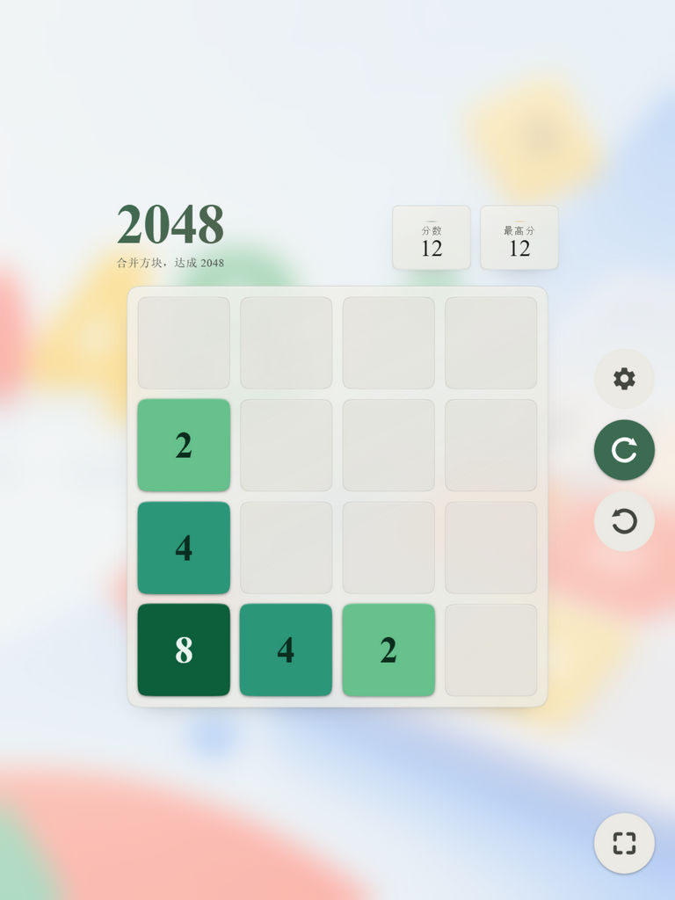
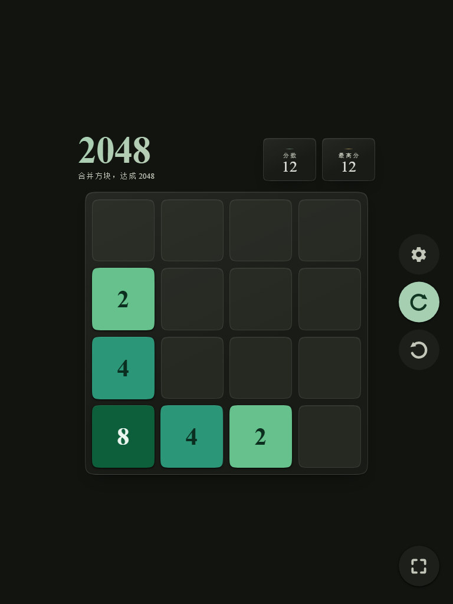

<p align="center">
  
  
</p>

<h1 align="center">2048 · Material Design</h1>

<p align="center">
  一款 Material Design 3 风格的 2048 游戏：单文件、零依赖、离线可玩。
</p>

* * *

## 特性

-   **Material Design 3** 视觉风格，森林绿主色与奶油底色
-   **两套配色**：国风配色（毛绿 · 湘蓝 · 流黄）与经典配色（绿金双阶）
-   **明暗主题**：跟随系统 / 浅色 / 深色，首帧无闪烁
-   **背景**：可关闭插画、保持默认，或选择本地图片作为背景（图片不写入 HTML）；自定义背景可调节毛玻璃模糊度
-   **三语界面**：中文 / English / 日本語，选择会被记住
-   **平板模式**：设置、新游戏、撤销与全屏按钮统一为 69px 圆形并对齐屏幕右端同一竖线，新游戏变为绿色镜像图标；窄屏自动回退横排
-   **键盘操作**：方向键或 `W` `A` `S` `D`
-   **触摸与鼠标拖拽**：跟手移动、挤压形变与边缘回弹动画
-   **撤销**：最多回退最近 20 步，方块原路返回、合并块分裂还原
-   **进度自动保存**：关闭或刷新页面后继续上一局，棋盘、分数与撤销记录都会保留
-   **终局破碎**：游戏结束点「再来一局」时，整盘方块炸成碎片后开新局
-   **达成 2048 后可继续**挑战更高分，最高分保存在本地
-   **响应式布局**，适配手机安全区，支持全屏模式
-   尊重系统的「减少动态效果」设置，提供无障碍标签与键盘可达性

整个游戏只有 **一个 HTML 文件**，字体与背景图均已内嵌，不需要网络、构建工具或依赖安装，断网也能直接玩。

## 平板模式预览

<p align="center">
  
  
</p>

开启设置中的「平板模式」后，设置、新游戏、撤销与全屏按钮统一为 69px 圆形，并停靠在屏幕右侧同一竖线；窄屏会自动回退到顶部横排。

## 操作说明

| 操作 | 方式 |
| --- | --- |
| 移动方块 | 方向键 / `W` `A` `S` `D`，或在棋盘上滑动 / 拖拽 |
| 新游戏 | 「新游戏」按钮 |
| 撤销 | 「撤销」按钮（最多 20 步） |
| 设置 | 齿轮按钮：配色、主题、背景、语言、平板模式 |
| 全屏 | 右下角全屏按钮（浏览器支持时显示） |
| 关闭弹窗 | `Esc` |

## 文件结构

```text
.
├── index.html          # 游戏本体（单文件，内嵌字体与背景图）
├── README.md
├── LICENSE             # MIT 许可证
├── .gitignore
├── .nojekyll           # 让 GitHub Pages 跳过 Jekyll 处理
└── docs/
    ├── preview-light.jpg
    ├── preview-dark.jpg
    ├── preview-tablet-light.jpg
    └── preview-tablet-dark.jpg
```

## 实现说明

-   纯 HTML / CSS / JavaScript，无框架、无外部请求。
-   游戏核心 `GameCore` 为纯函数实现，负责滑动、合并、计分与状态判断。
-   内嵌了新宋体（NSimSun）子集约 90KB，收录整页文案用字（含日文假名与标点），保证不同平台的中文字形一致；两张明暗背景图内嵌于 CSS 中（合计约 3.2MB），因此 `index.html` 约 4.5MB，首次加载后由浏览器缓存。
-   动画基于 `requestAnimationFrame` 与 Pointer Events，包含拖拽跟手、方块挤压和边缘弹簧回弹。
-   仅使用 `localStorage` 保存最高分、当前进度与界面偏好（`md2048-best`、`md2048-save`、`md2048-theme`、`md2048-palette`、`md2048-lang`、`md2048-bg`、`md2048-bg-url`、`md2048-bg-name`、`md2048-bg-blur`、`md2048-tablet`），不会上传任何数据。
-   自定义背景图片只在运行时按 URL 引用（object URL，刷新后先尝试与 HTML 同目录的原文件名），不会写入 HTML；地址失效时自动回退到默认背景。毛玻璃模糊度通过 CSS 变量 `--scene-custom-filter` 即时生效，默认 0（原图清晰），最大 40px。

## 浏览器支持

适用于支持 Pointer Events、CSS 自定义属性与 `backdrop-filter` 的现代浏览器（Chrome、Edge、Firefox、Safari）。旧浏览器或关闭动画时，交互会退回为普通滑动，不影响正常游玩。

## English

A single-file 2048 game with a Material Design 3 look. No dependencies, no build step, fully offline. It features two color palettes, light/dark themes, Chinese/English/Japanese UI, keyboard and pointer-drag controls, up to 20 undo steps, automatic progress saving across reloads, and a locally stored best score.

Deploy with GitHub Pages by setting the branch to `main` and the folder to `/ (root)`.

The code and original assets are released under the [MIT License](LICENSE).

## 许可证

本项目采用 [MIT 许可证](LICENSE)，可自由使用、修改和分发，但需保留版权与许可声明。

> 代码与原创素材采用 MIT 许可证；如内嵌字体或背景图来自第三方，其权利仍归原权利人所有。