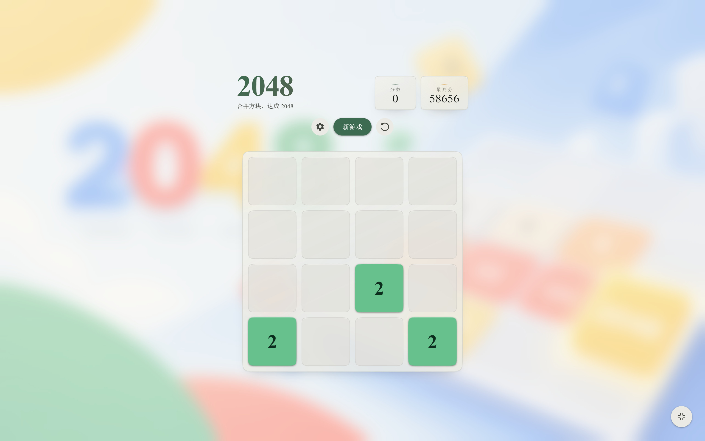
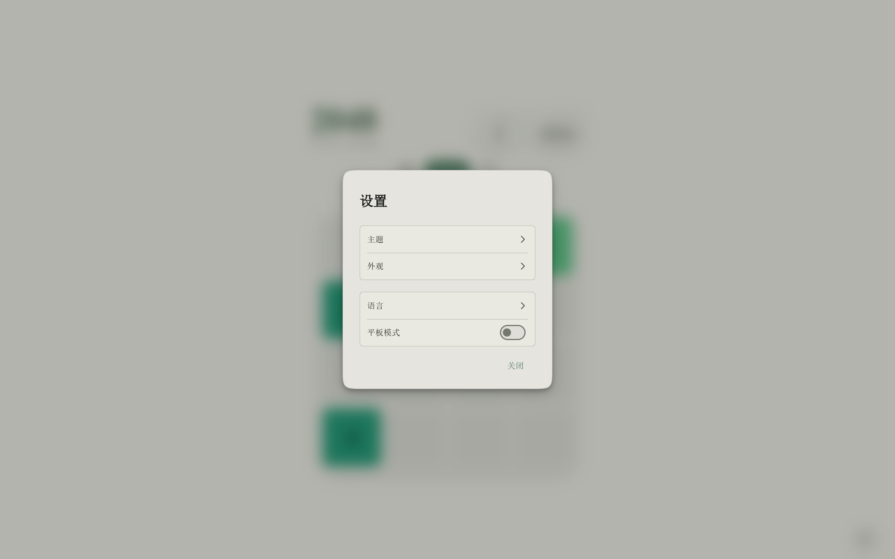
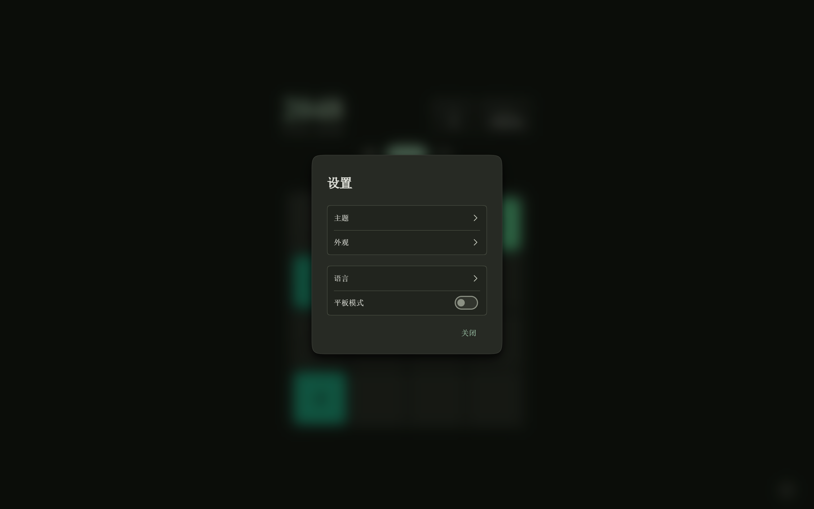

<h1 align="center">2048 · Material Design</h1>

<p align="center">
  A responsive, single-file 2048 game inspired by Material Design 3.
</p>

## Overview

Play in your browser with no installation, dependencies, or network connection. The complete game—including its styles, scripts, and fonts—is contained in `index.html`.

## Features

- **Gameplay:** Reach 2048, then keep playing. Undo up to 20 moves, and resume your saved game after a reload.
- **Input:** Use the arrow keys or `W` `A` `S` `D`. Swipe or drag on the board or any blank area of the page.
- **Appearance:** Guofeng is the default color scheme. Choose Classic or use the current background image to color the interface and tiles. Light and dark mode are independent of this setting.
- **Custom backgrounds:** Select an image from your device and adjust its blur. The image is referenced locally and is not added to the HTML file.
- **Language:** Switch between Chinese and English; your preference is remembered.
- **Responsive layouts:** Play on desktop, tablet, and phone. On phones, action buttons dock at the bottom automatically. Tablet mode docks them along the right edge.
- **Motion and accessibility:** Supports reduced-motion preferences, keyboard access, and accessible labels. Game-over effects use a tile-shatter animation.

## Screenshots

### Desktop

<p align="center">
  
  
</p>

### Desktop Settings

<p align="center">
  
  
</p>

## How to Play

Combine matching tiles to reach 2048. After reaching 2048, you can continue playing for a higher score.

| Action | Input |
| --- | --- |
| Move tiles | Arrow keys, `W` `A` `S` `D`, or swipe or drag on the board or a blank area |
| Start a new game | Select **New Game** |
| Undo a move | Select **Undo** (up to 20 moves) |
| Open settings | Select the gear button |
| Close a dialog | Press `Esc` |
| Toggle fullscreen | Select the fullscreen button when your browser supports it |

## Settings

Use the settings panel to change the color palette, theme, language, and background. Tablet mode is available on larger screens. On phone-sized screens, the action buttons move to the bottom automatically; the fullscreen button appears when supported by the browser.

The game saves your current board, score, undo history, best score, and interface preferences in the browser's `localStorage`. Data stays on your device and is not uploaded. A custom background image itself is not stored in the HTML file.

## Run or Deploy

Open `index.html` in a modern browser to play locally. To host the game with GitHub Pages, select the `main` branch and the `/ (root)` folder in the repository's Pages settings.

### Background color palette

Choosing or replacing a custom background image automatically selects and saves **Follow Background** once the game can sample its dominant color. The interface and tiles use that color. You can still choose Guofeng or Classic under **Settings → Appearance → Color Scheme**.

Restoring an existing image on refresh or turning it back on does not override your saved palette. If the background is off, missing, or unreadable, Follow Background is disabled. If it was selected, the game saves Guofeng instead. Legacy system palette selections also revert to Guofeng; existing Classic selections are kept. **Settings → Theme** still controls light and dark mode.

## Project Structure

```text
.
├── index.html
├── README.md
├── LICENSE
├── .gitignore
├── .nojekyll
└── docs/
    ├── preview-dark.jpg
    ├── preview-light.jpg
    ├── preview-desktop-settings-dark.png
    └── preview-desktop-settings-light.png
```

## Implementation

- Built with plain HTML, CSS, and JavaScript. There is no framework, build step, or external request.
- `GameCore` handles tile movement, merging, scoring, and game-state checks as pure functions.
- Interface fonts are embedded as WOFF2 subsets. The HTML is approximately 0.33 MB.
- Drag interactions use Pointer Events and `requestAnimationFrame`, with responsive tile movement and edge rebound effects.
- Browser storage keys use the `md2048-` prefix. The game does not send saved data to a server.

## Browser Support

Designed for modern versions of Chrome, Edge, Firefox, and Safari. The game uses Pointer Events, CSS custom properties, and `backdrop-filter`. Reduced-motion preferences disable motion effects while preserving normal gameplay.

## License

The code and original assets are provided under the [MIT License](LICENSE). Any third-party font rights remain with their respective owners.
